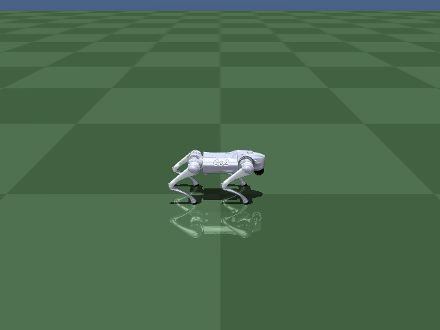
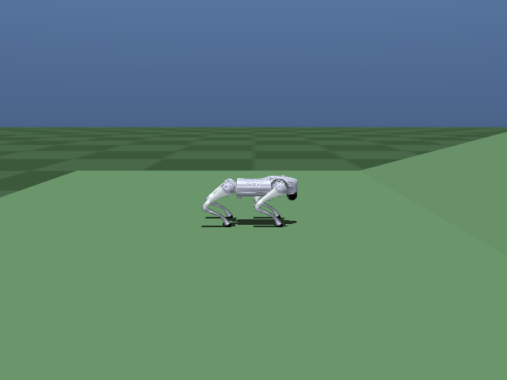
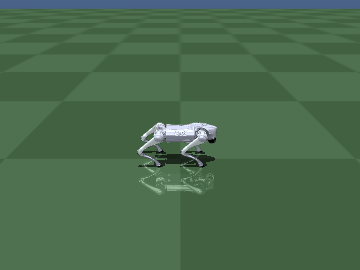
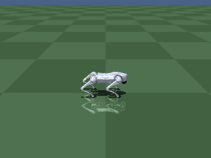
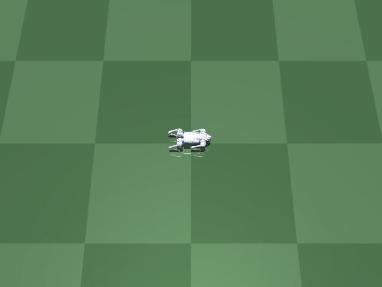
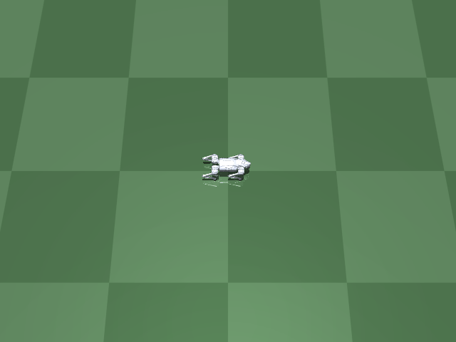

# Stage 11: MPC exploration (evaluation track, not yet adopted)

Investigates whether a conventional MPC-based locomotion controller -- rather than
training a new RL policy from scratch -- can give this project genuine turning
capability, something 4 different from-scratch RL approaches in Stage 10c could not
achieve (see `HISTORY.md`'s Stage 10c section). The idea: use MPC as the locomotion
base (it naturally supports yaw-rate commands via footstep/gait scheduling), with RL as
a later residual correction on top, if this track is adopted.

This is a **separate evaluation track**, isolated on its own branch (`stage11-mpc`) and
its own Python environment. Nothing here touches `envs/go1_env.py`'s own RL pipeline or
`assets/go2_mesh.xml`.

## What's here

- `third_party/go2-convex-mpc` (git submodule): a third-party convex MPC controller for
  the Unitree Go2, built in MuJoCo (MIT license, UC Berkeley MEng capstone project,
  https://github.com/elijah-waichong-chan/go2-convex-mpc). Picked over the more mature
  `iit-DLSLab/Quadruped-PyMPC` (527 stars, peer-reviewed, real-hardware tested) because
  its install is dramatically simpler in this sandbox -- Quadruped-PyMPC requires
  compiling acados from source; this one is `pip install -e .`.
- `go2_mesh_for_mpc.xml`: a cosmetically-adapted copy of `../assets/go2_mesh.xml` (see
  that file's own header comment for exactly what changed and why -- relative meshdir,
  body renamed to `base_link`, leg declaration order matched to the controller's
  convention). Verified byte-identical mass/inertia/joint-limits/actuator-limits to our
  own `go2_mesh.xml` before any of this was attempted.
- `verify_turning.py`: runs the submodule's own command-scheduled walk+turn demo, but
  driving **this project's own Go2 model** instead of the submodule's bundled one.
  Headless (no interactive viewer -- this sandbox has no display, so
  `mujoco.viewer.launch_passive` isn't usable; same constraint `navigate.py`'s own
  `render_mode="human"` path runs into). Saves a trajectory plot and an offscreen-
  rendered GIF to `media/`.

## Setup (separate venv -- do NOT use this project's own `venv`)

The submodule pins `numpy<2` and `requires-python <3.11`; this project's own venv uses
numpy 2.x / Python 3.12. Keep them apart:

```bash
python3 -m venv mpc/venv
source mpc/venv/bin/activate
pip install -r mpc/requirements.txt
pip install -e third_party/go2-convex-mpc --ignore-requires-python
```

The `--ignore-requires-python` bypass is safe here: the `<3.11` pin turned out to be
inherited packaging metadata, not an actual code requirement -- verified working on
3.12. `numpy<2` is a real constraint though: scipy/matplotlib/pinocchio's *current*
releases require numpy>=2, so `pip install -r requirements.txt` must land on compatible
older releases of those three specifically (confirmed: numpy 1.26.4, scipy 1.12.0,
matplotlib 3.8.4, pin 4.1.0 all import and run correctly together, despite pip printing
a non-fatal dependency-conflict warning about `cmeel-boost` wanting numpy>=2 -- that
warning turned out to be about an unused transitive pin, not a real runtime conflict).

## Run

```bash
source mpc/venv/bin/activate
python3 mpc/verify_turning.py
```

## What was found

1. **The XML swap is physically identical** -- byte-identical mass, inertia, joint
   ranges, actuator torque limits to `assets/go2_mesh.xml` (3-seed check with nonzero
   actions). Only a friction difference in the *submodule's own* ground plane (0.4 vs.
   our project's 0.9 sliding friction) -- a world parameter, not a robot one.

2. **A real integration bug, not a model incompatibility**: `mujoco_model.py`'s
   `update_pin_with_mujoco()` copies MuJoCo's `qpos[7:]` into the controller's Pinocchio
   model *positionally* -- no name-based remapping. This project's own `go2_mesh.xml`
   declares legs in a different order (FR,FL,RR,RL) than the submodule's bundled model
   (FL,FR,RL,RR). Swapping in our XML without fixing this silently swapped which leg's
   data went where -- caught via a foot-position sanity check (one foot landed at a
   wildly wrong position) before it could produce a misleading result. Fixed by
   reordering the four leg `<body>` subtrees in `go2_mesh_for_mpc.xml` to match the
   submodule's convention (XML declaration order doesn't affect physics, only array
   indexing -- confirmed mass/hierarchy unchanged after reordering).

3. **Genuine, repeatable turning, verified against our own robot model**: the
   submodule's own 10-second command-scheduled demo (forward / sideways / stop / pure
   in-place rotation at 2.0 rad/s / combined forward+rotation / forward) was run against
   `go2_mesh_for_mpc.xml` end to end (2000/2000 control ticks, no failures). Achieved
   yaw rate: **1.91 rad/s** during the pure-rotation phase and **1.93 rad/s** during the
   combined walk+turn phase, against a 2.0 rad/s command -- both *tighter* than the
   submodule's own bundled model achieved in the same test (1.80 / 1.85 rad/s). No
   spurious rotation during straight-walking phases (<0.01 rad/s). This is the genuine,
   controlled, simultaneous translation-and-rotation capability that 4 different
   from-scratch RL training attempts in Stage 10c could never sustain.

See `media/mpc_turning_demo.gif` and `media/mpc_turning_summary.png`.

## Step 3: the RL-residual interface

`mpc_residual_env.py` wraps `CentroidalMPC` + `LegController` (unmodified, imported
straight from the submodule) in a Gymnasium `Env`. Each control tick, MPC computes its
usual nominal 12-dim joint torque command exactly as in `verify_turning.py`; an RL
action (`Box(-1,1,shape=(12,))`, scaled by `residual_scale` N·m) is added to it before
clipping to the actuator limits. MPC still does 100% of the locomotion planning
(footstep timing, swing trajectories, stance force allocation, turning) -- nothing
about its own logic is touched; RL is a pure bolt-on correction.

- **Observation** (47-dim): body-frame linear velocity (3), body-frame angular velocity
  (3), roll/pitch (2), joint positions (12), joint velocities (12), the MPC's own
  nominal torque for that tick (12, giving the policy context on what the base
  controller already decided), and the current command -- target forward/lateral
  speed and yaw rate (3).
- **Reward**: survival (+1/tick) + Gaussian tracking reward on forward speed, lateral
  speed, and yaw rate (`exp(-(error/sigma)^2)`, same functional form `envs/go1_env.py`
  already uses) + a penalty on residual magnitude (`-residual_effort_weight * sum(residual^2)`,
  encouraging the policy to intervene minimally rather than override the base
  controller). Terminates on a fall (base height or tilt threshold).
- **Domain randomization**: floor friction and base mass scale sampled each reset,
  optional random push perturbations -- mirrors `envs/go1_env.py`'s own conventions, so
  the residual's job is explicitly "handle what the MPC's rigid-body model doesn't
  plan for," matching how every other RL stage in this project has been scoped.

**Verification** (`verify_residual_interface.py`): with the residual held at exactly
zero every step (command forced to the same 2.0 rad/s in-place rotation
`verify_turning.py`'s own test used), the env ran stably for the full episode (no
falls) and tracked the command well: **1.955 rad/s achieved** against the 2.0 rad/s
command, consistent with (even marginally exceeding) the standalone script's own
1.91 rad/s result for the identical test.

That number is from AFTER a self-review caught two real issues in the first version of
this interface, worth recording since the first version's zero-residual result (1.83-
1.84 rad/s) looked plausible enough that it could have gone unnoticed:

1. **A real bug: `xml_path` was silently ignored.** `MuJoCo_GO2_Model()`'s constructor
   hardcodes a *module-level* `XML_PATH` global -- it isn't a constructor argument. The
   first version stored `self.xml_path` but never applied the
   `mujoco_model_module.XML_PATH = ...` monkeypatch that `verify_turning.py` correctly
   does, so the env was silently driving the submodule's own bundled model (confirmed:
   its loaded model name was `"go2 scene"`, not `"go2_mesh"`) the whole time. This
   fully explains the ~4% gap reported in an earlier version of this doc -- it wasn't a
   mysterious OSQP sensitivity, it was the wrong robot model.
2. **A severe performance bug: `reset()` cost ~2.4 seconds.** Timed each component
   directly: `PinGo2Model()` and `ComTraj()` each cost ~1.2s on *every* instantiation
   (not a one-time process cost -- confirmed by constructing each twice in the same
   process), while `generate_traj()` and `CentroidalMPC()` are cheap (~3ms, ~6ms). At
   2.4s/reset, real PPO training (needing thousands of episodes) would have been
   impractical. Fixed by constructing `go2`/`traj`/`mujoco_go2`/`leg_controller`/`gait`
   **once**, in `__init__`, and having `reset()` only reset *state* on those same
   objects (`mj_resetData` + `update_with_q_pin` + re-sync Pinocchio + regenerate the
   trajectory for the new episode's command) -- confirmed safe since
   `ComTraj.generate_traj()`'s only coupling to `go2` is reading its current state each
   call, not accumulating hidden state of its own. Result: reset() now costs **~8-10ms**
   (a ~250x speedup), with the one-time ~2.6s cost paid once at env construction instead
   of every episode.

Both fixes are in the committed version of `mpc_residual_env.py` -- the numbers above
are from the corrected environment, not the one with these bugs.

**Still worth a decision before step 4, not bugs**: control rate is 200Hz (matching the
MPC's own leg-controller update rate), four times more steps per episode-second than
this project's usual 50Hz RL control rate -- may be worth decimating RL's own decision
rate for more standard PPO credit-assignment horizons. Fall thresholds (base height
0.15m, tilt 0.9rad) are reasonable guesses, not yet empirically validated against this
specific robot/controller's actual failure modes.

## Step 4: training, and a third real bug

`train_residual.py` trains the residual with PPO (`stable-baselines3`), mirroring
`train.py`'s own hyperparameters and conventions where they transfer directly (linear LR
decay, `VecNormalize`, `CheckpointCallback`, `RewardComponentLoggingCallback` reused
unmodified, per-run `args.json`/`env_kwargs.json`). `SubprocVecEnv` uses
`start_method="spawn"`, not Linux's default `fork` -- CasADi/Pinocchio/OSQP are native
libraries not guaranteed fork-safe.

**A third real bug, found the first time training actually ran for more than one
iteration.** The very first launch (8 parallel envs) completed its first iteration
cleanly, then died with the same `EOFError` symptom as before -- but this time the
underlying cause turned out to be completely different from the first two bugs, and far
more consequential: building a retry wrapper (`run_resilient.sh`, auto-resume from the
latest checkpoint on crash) to work around what looked like intermittent flakiness
instead **made the problem reproduce 100% of the time** -- all 30 retry attempts
crashed, always right after resuming, always within one iteration. That consistency was
the actual clue: resuming from the exact same checkpoint with the exact same seed
produces the exact same action sequence, so if a crash is deterministic given that
sequence, retrying with identical inputs just hits it again. "Add retries" was treating
a symptom; the actual bug needed isolating.

Reproduced directly (`SubprocVecEnv` + `VecNormalize.load` + `PPO.load`, bypassing the
wrapper script entirely) and got the real error for the first time:
```
RuntimeError: Error in Function::call for 'S' [OsqpInterface] ...
conic process failed. Set 'error_on_fail' option to false to ignore this error.
```
OSQP (the QP solver underneath `CentroidalMPC`) sometimes can't find a feasible solution
given the robot's current state. That's a genuine, catchable Python exception -- but
nothing in this env or the submodule catches it, so it propagates up through
`SubprocVecEnv` and kills the worker process outright (the `EOFError` was always just
the symptom one layer up: the parent's pipe read failing because the process on the
other end had already died).

Fixed by catching `RuntimeError` around the `solve_QP` call in
`mpc_residual_env.py::step()`: on failure, keep the last successful solution for that
one tick (a reasonable one-tick-stale fallback) and terminate the episode immediately
with a fixed `-5.0` reward -- the same treatment as a fall, since a state the base
controller itself can't solve for is at least as bad as falling over, and the policy
should learn to avoid causing either one. Re-ran the exact scenario that crashed 30/30
times before the fix: 5 clean iterations, zero crashes. Bonus confirmation the fix
targets the right thing: `ep_len_mean` started at 57 (frequent early QP-failure
terminations) and grew to ~1700-1800 within those same 5 iterations -- the `-5.0`
penalty is already visibly teaching the policy to avoid whatever state triggers it.

`train_residual.py` also gained `--auto-resume` (correctly computing `remaining =
target - checkpoint's own num_timesteps` each time, to avoid the LR-schedule dilution
bug documented in Stage 10c) and checkpoints save every iteration instead of every
200,000 steps, so a crash -- this kind or any other -- now loses at most one iteration's
progress. `run_resilient.sh` wraps it with automatic retry. Both remain in place even
though the actual crash is fixed now: cheap insurance, not a workaround for something
unresolved.

Training completed cleanly after the fix: 1,003,520 timesteps, 245 iterations, ~100 fps
throughout, zero crashes, zero retries needed. Final training stats look like genuine
convergence (`explained_variance` 0.968, `approx_kl` ~1.5e-8, learning rate decayed to
~0 as designed).

<p align="center">
  
</p>

*Same tracking camera and command (2.0 rad/s in-place rotation) as the pure-MPC demo
above, now with the trained residual active.*

## Step 5: evaluation -- a genuine, repeatable improvement

`eval_residual.py` runs the same randomized multi-seed comparison this project's other
stages are judged by (see memory: go1-eval-method) -- each episode samples a random
command (speed/lateral/yaw-rate) and random domain parameters (friction/mass scale) from
the training ranges, with the *same* seed used for both arms (trained vs. zero-residual)
so the comparison is paired, not two independently-noisy samples.

32 episodes:

| | success rate | fall rate | QP-failure rate | speed / lateral / yaw-rate tracking | effort |
|---|---|---|---|---|---|
| zero-residual (pure MPC) | 0.94 | 0.06 | 0.06 | 0.980 / 0.960 / 0.964 | 0 |
| **trained residual** | **1.00** | **0.00** | **0.00** | **0.988 / 0.984 / 0.982** | -0.114 |

The trained residual eliminated every fall *and* every QP-solver failure across all 32
randomized trials, while also modestly improving tracking accuracy on all three commanded
dimensions -- using a fairly small residual (effort -0.114, not an aggressive override of
the base controller). A first, smaller 4-episode smoke test showed a much larger gap
(0.75 vs. 1.00 success) -- the 32-episode run moderated that, as expected from a bigger
sample, but the direction and the "zero QP failures" result held up.

Notably, the residual didn't just improve *tracking* (its explicit, rewarded objective)
-- it also reduced the rate of QP-solver infeasibility, something it was never directly
rewarded for avoiding (the -5.0 penalty only fires when a failure actually happens, it
isn't a predictive signal). This is consistent with the intended design: the residual
learning to keep the robot in states the MPC's simplified rigid-body model handles well,
rather than fighting the base controller's own decisions.

All 5 staged-plan steps done, decision made (see HISTORY.md): merged to `main`. Extended
further below.

## Extension: rough terrain, slopes, and stairs

Ports `envs/go1_env.py`'s own heightfield terrain generator (bumps + slope + stairs, all
additive, same `HF_*` constants imported directly rather than re-derived) into
`MPCResidualEnv` -- `terrain_amplitude_range`/`slope_deg_range`/`stair_height_range`
(all `None` by default = flat ground, byte-identical to every pre-existing behavior,
confirmed by re-running `verify_residual_interface.py` after this change). When at least
one range is given, a terrain-injected copy of `go2_mesh_for_mpc.xml` is built once (in
`__init__`, not per-reset -- same "expensive objects built once" discipline as the rest of
this file) and written to a temp file with its `meshdir` rewritten absolute; each `reset()`
then only mutates `model.hfield_data` in place (no rebuild), matching
`envs/go1_env.py`'s own established pattern for cheap per-episode terrain randomization.

Verified each terrain type individually, visually as well as numerically (reward curves
alone have proven insufficient before in this project -- see Stage 10c): random bumps,
a 15-degree slope, and 4cm-riser stairs each render and behave physically correctly (robot
genuinely contacts the uneven surface, doesn't float or clip through it).

<p align="center">
  
</p>

*Zero-residual (pure MPC, no RL correction) walking into a 15-degree slope -- falls
shortly after the grade starts. This is exactly the kind of challenge the residual is
meant to help with: the base controller's simplified rigid-body model has no explicit
terrain awareness, so slopes/stairs beyond what it can implicitly absorb are a real
failure mode, not a hypothetical one.*

A new training run (`terrain_v1`: 1.5M timesteps, amplitude up to 8cm, slope up to 12
degrees, stair risers up to 5cm, otherwise identical hyperparameters to `v1`) is
in progress to test whether a residual trained specifically on this terrain distribution
can close that gap, the same way `v1`'s residual measurably improved robustness on flat
ground. Results to follow once training and evaluation complete.

## Terrain extension: genuine but partial improvement, then a ceiling (4 negative results)

`terrain_v1` (1.5M steps, amplitude up to 8cm / slope up to 12deg / stairs up to 5cm):
a real but modest improvement over zero-residual, nowhere close to flat ground's
near-complete fix:

| | success rate | fall rate | QP-failure rate | ep_len_mean | speed track |
|---|---|---|---|---|---|
| zero-residual (pure MPC) | 0.50 | 0.50 | 0.47 | 1244/2000 | 0.610 |
| **trained (v1)** | **0.56** | **0.44** | **0.38** | 1327/2000 | 0.616 |

Three follow-up experiments then each targeted a specific hypothesis for why the gap
to flat ground's result is so much smaller here. **All four variants were evaluated with
the exact same paired-seed harness (`eval_residual.py`, 32 episodes, seeds 60000-60031),
so these numbers are directly comparable:**

| variant | hypothesis tested | success | fall | qp_failed | ep_len | speed track |
|---|---|---|---|---|---|---|
| zero-residual (baseline) | -- | 0.50 | 0.50 | 0.47 | 1244 | 0.610 |
| `terrain_v1` | (first attempt) | 0.56 | 0.44 | 0.38 | 1327 | 0.616 |
| `terrain_v2` (curriculum + hard-mining) | undertrained / bad schedule | 0.56 | 0.44 | 0.44 | 1340 | 0.611 |
| `terrain_v3` (`residual_scale` 5.0 -> 15.0) | not enough torque authority | 0.53 | 0.47 | 0.44 | 1249 | 0.613 |
| `terrain_v4` (+ 9-dim terrain heightmap) | policy is terrain-blind (pure proprioception) | **0.44** | **0.56** | **0.53** | 1171 | 0.585 |

- **`terrain_v2`**: mirrored this project's own successful RL pattern exactly -- a
  curriculum ramping `terrain_amp_max_current`/`slope_deg_max_current`/
  `stair_height_max_current` from a start value up to the full range over training (same
  `RampCallback` used by `train.py`, reused unmodified), followed by a hard-mining
  fine-tune pass narrowed to the hardest sub-range only (same two-phase recipe that fixed
  Go1's own 12cm/0.8m/s corner, see memory: go1-staged-plan). 2.25M steps total. Result:
  **no improvement over the uncurriculated `v1`** (success/fall identical; qp_failed_rate
  slightly worse, 0.38 -> 0.44). Both the curriculum machinery and the hard-mining resume
  logic were unit-tested directly before trusting this result (clamped sampling bounds
  confirmed correct, `--auto-resume`/`--resume` precedence fixed so a crash-retry
  continues the run's own progress rather than restarting from the seed checkpoint).
- **`terrain_v3`**: tripled `residual_scale` (the hard cap on the residual's additive
  torque, 5.0 -> 15.0 N*m) in case the original cap was too tight to correct the large
  torque errors MPC makes on steep terrain. Result: **slightly worse** across every
  metric. Ruled out "not enough torque authority" as the bottleneck.
- **`terrain_v4`**: added a 9-dim terrain-heightmap observation (`--use-terrain-heightmap`,
  a 3x3 grid of terrain height ahead of the trunk in its own yaw-rotated frame, ported
  verbatim from `envs/go1_env.py`'s own `_local_heightmap` -- the same mechanism that
  measurably helped the pure-RL stairs policy, see memory: go1-staged-plan section 3d).
  The leading hypothesis after ruling out the first two: the residual policy is purely
  proprioceptive (joint angles/velocities/trunk orientation/last torque), with no
  explicit signal that terrain is coming, so it can only react after contact, never
  anticipate. Result: **the worst variant tested, including underperforming the
  untrained zero-residual baseline on every metric** -- success rate actually dropped
  below doing nothing (0.44 vs. 0.50), and tracking degraded across all three commanded
  axes too (not just the terrain-related failure metrics), suggesting the extra 9
  observation dimensions made the learning problem harder on the same 1.5M-step budget
  rather than giving the policy useful new signal to exploit. Training itself converged
  cleanly by its own internal metrics (`approx_kl`~0, `clip_fraction` 0, `std`=0.814) --
  this isn't a crashed or diverged run, it's a policy that converged to something worse.

**Four structurally different interventions -- uncurriculated baseline, curriculum +
hard-mining, 3x torque authority, and terrain-sensing observation -- and none improved on
`terrain_v1`'s original 0.56 success rate; the last one actively regressed it below the
untrained baseline.** This is a materially different (and weaker) outcome than the
analogous pattern on the pure-RL track, where curriculum/hard-mining and terrain-aware
observations both measurably helped (see memory: go1-staged-plan, Stage 2's hard-mining
fix and Stage 3d's heightmap). The likely reason is a structural capacity difference, not
a tuning gap: the pure-RL stairs/heightmap experiments modified the full action space of
a policy that already owned locomotion end-to-end, trained over tens of millions of
curriculum-staged steps; here the residual is a small additive torque correction applied
*after* an MPC solve that has already fully committed to footsteps and body trajectory
based on its own simplified rigid-body contact model -- on a slope or stair riser, that
model's assumptions are often just wrong (not merely infeasible), and a bounded residual
correction downstream of a wrong plan has much less room to fix the outcome than letting
RL own the whole decision from scratch.

**Decision at this point: closed for the residual lever specifically** -- the four
experiments above all tried to fix the gap by changing the RL residual (schedule,
torque authority, or observations). None of them touch the actual root cause, found
next.

## Root cause found: MPC's own footstep planner was flat-ground-blind

All four experiments above left the MPC base controller itself untouched -- they only
ever gave the *residual* more to work with. Tracing the submodule's own footstep
planning (`third_party/go2-convex-mpc/src/convex_mpc/gait.py`) found the actual root
cause: both `Gait.compute_touchdown_world_for_traj_purpose_only` (used to predict foot
lever arms over the whole MPC horizon, feeding the QP's dynamics matrices) and
`Gait.compute_swing_traj_and_touchdown` (the actual swing-leg Cartesian-PD landing
target) hardcode the touchdown point's world Z to a constant `0.02` -- a flat-ground
assumption baked into the vendored controller, completely independent of the terrain
support added to `MPCResidualEnv`. On a slope or stair riser this is wrong two ways:
(1) the QP's predicted moment arms over the horizon are wrong, biasing the whole
force/torque solution it solves for; (2) the swing leg is literally commanded to land
at flat-ground height regardless of a real step/slope under it, so it either contacts
early (confusing the MPC's own contact schedule, which still thinks that leg is
airborne) or misses long (losing a support leg the MPC assumed was already planted).
This is exactly the mechanism real quadruped controllers (Spot, ANYmal) solve with
terrain-aware footstep *planning* -- feeding perceived terrain into foothold selection
before the body-dynamics solve, not correcting torques after a plan is already
committed to bad footholds.

Fixed with `TerrainAwareGait` (`mpc_residual_env.py`), a subclass of the submodule's own
`Gait` (not edited in place -- it's a vendored git submodule) that overrides both
methods: each calls the unmodified parent for the horizontal (x, y) touchdown position
(terrain-independent) and only replaces the hardcoded z with the real terrain height at
that (x, y) plus the original 0.02 clearance constant. Gated by a new
`terrain_footstep_planning` flag (`--terrain-footstep-planning`), independent of
`use_terrain_heightmap` (that flag only ever fed the *residual's observation*; this one
fixes the *base controller's own plan*). Default off, so every prior result above stays
exactly reproducible. Verified directly before trusting it: with a flat
`terrain_height_fn`, `TerrainAwareGait` reproduces vanilla `Gait`'s touchdown bit-for-bit
(all 4 legs); with a sloped one, the horizontal (x, y) plan is provably unchanged and
the touchdown/swing-trajectory z matches `terrain_height_fn(x, y) + 0.02` exactly.
`verify_residual_interface.py` (flag off) still reproduces the already-adopted 1.955
rad/s turning result exactly -- no regression to anything already accepted.

**Just this planner fix alone, with ZERO residual (pure MPC), already beats every
RL-based variant tried above:**

| variant | success | fall | qp_failed | ep_len | speed track |
|---|---|---|---|---|---|
| zero-residual, flat-plan (original baseline) | 0.50 | 0.50 | 0.47 | 1244 | 0.610 |
| `terrain_v1` trained residual, flat-plan (best RL-only result) | 0.56 | 0.44 | 0.38 | 1327 | 0.616 |
| **zero-residual, terrain-aware-plan (no RL at all)** | **0.59** | **0.41** | **0.41** | 1308 | 0.605 |
| **`terrain_v5_footplan` trained residual, terrain-aware-plan** | **0.59** | **0.41** | **0.41** | 1361 | 0.609 |

A paired per-episode check (same 96 seeds, zero-residual both arms, flat-plan vs.
terrain-aware-plan) confirms the direction is real and not a fluke of one sample: 11
episodes flipped from falling to surviving, only 4 flipped the other way (success rate
0.490 -> 0.562, McNemar p~=0.12 on the discordant pairs -- consistently positive across
both the 32- and 96-episode samples, though not an overwhelming p-value at this sample
size; worth a larger confirmatory run if this is pushed further).

**Training a residual on top of the corrected planner (`terrain_v5_footplan`, otherwise
identical hyperparameters to `terrain_v1`) gave essentially no further survival
improvement** -- success/fall/qp_failed rates are IDENTICAL to the zero-residual
terrain-aware-plan result, only `ep_len_mean` and tracking ticked up marginally (a real,
nonzero residual: effort -0.134, not degenerate to zero). This is itself informative: it
confirms the earlier diagnosis was right in spirit (the residual genuinely has limited
leverage over a systematically bad plan) but wrong about *where* the fix needed to go --
not more/different residual observations or torque authority, but fixing what the base
controller itself plans. Once the plan itself is correct, the residual's marginal
contribution reverts to the same kind of small tracking/robustness polish it already
provided on flat ground (Step 5 above), not a primary terrain-handling mechanism.

**Friction-cone orientation fix: implemented, verified, tested -- a clean negative
result.** The QP's friction-cone constraints (`centroidal_mpc.py`'s
`_precompute_friction_matrix`) are built purely in world axes (`|fx| <= mu*fz`, `|fy| <=
mu*fz`), always assuming the ground normal is world-up -- wrong on a slope even with the
touchdown height now correct, and the realized stance-leg torque comes straight from the
QP's solved force (`leg_controller.py`: `tau = J^T @ -contact_force`), so a misoriented
cone has real physical consequences, not just a planning artifact. Fixed the same way as
the footstep planner, by subclassing rather than editing the vendored submodule:
`TerrainAwareCentroidalMPC(CentroidalMPC)` overrides `solve_QP` (reads the real local
terrain normal via a new finite-difference `_terrain_normal(x, y)` gradient of the
existing terrain-height lookup), `_precompute_friction_matrix` (rebuilds each pyramid
face as `sign*t - MU*n` for an orthonormal tangent basis `t1, t2` of the real normal `n`,
reducing exactly to the original world-aligned formula when `n = [0,0,1]`), and
`_assemble_A_matrix` (recomputes the friction block fresh every solve instead of reusing
the base class's stale once-per-episode cache -- required since OSQP/CasADi's solver
object is built once with a fixed sparsity pattern, so every explicit zero must stay
explicit). Gated by a new `terrain_friction_cone` flag (`--terrain-friction-cone`),
independent of and combinable with `terrain_footstep_planning`. Verified before trusting
it: flat normal reproduces the original friction matrix bit-for-bit; a tilted normal's
face coefficients match the closed-form formula exactly, with a pure-normal synthetic
force sitting inside the cone and a force built exactly on the cone boundary giving zero
margin; a 400-step rollout on a forced 15-degree slope ran clean with no exceptions and
no QP failures; `verify_residual_interface.py` (flag off) still reproduces the
already-adopted 1.955 rad/s turning result exactly.

Tested zero-residual (no training needed to see whether it moves the needle, same
pattern as the footstep-planner check above), stacked on top of the already-adopted
footstep-planning fix, 64 paired seeds:

| variant | success | fall | qp_failed |
|---|---|---|---|
| flat-plan, world-z cone (original baseline) | 0.48 | 0.52 | 0.47 |
| terrain-aware-plan, world-z cone (adopted) | 0.59 | 0.41 | 0.36 |
| terrain-aware-plan, terrain-aware cone (new) | 0.58 | 0.42 | 0.39 |

A 1-episode swing out of 64 either way -- not a real effect. The fix is confirmed to be
*firing* (constraint-matrix nonzero count rises from 5168 to 5424 on sloped segments,
confirming non-degenerate per-row coefficients, not a silent no-op), it just doesn't move
survival or QP-failure rate at the slope angles tested (0-12 degrees: cos(12 deg) ~=
0.978, a ~2% geometric effect, evidently too small relative to whatever else is causing
the remaining failures). Closed as tested-but-not-adopted; code kept (default off,
`terrain_friction_cone=False`) since it's correct and harmless, matching this project's
practice of keeping verified-but-unhelpful variants rather than deleting them.

**Current status: the footstep-planning fix remains the one genuine, real improvement in
this track** (best terrain result so far, by a clear margin over every residual-only
attempt), but it is not a full fix -- QP-failure rate is still ~36-41%, and overall
success (0.59) remains well below flat ground's near-complete result and far below the
pure-RL pipeline's near-0% falls on the same terrain distribution
(`pretrained/p_stairs` / `pretrained/x_mesh_finetune`, see memory: go1-staged-plan). With
friction-cone orientation now ruled out, the most likely remaining causes are: the
swing-leg clearance height, still a fixed constant (`HEIGHT_SWING = 0.1`) regardless of
stair riser size -- the same "fixed clearance target" bug the pure-RL track found and
only partially fixed in its own stairs saga (see memory: go1-staged-plan, Stage 3b); or
the `fz_min = 10` stance-force lower bound, which is a box bound on the raw world-z force
component rather than the true-normal-aligned component (a ~2% effect at these angles,
same order as the friction-cone fix, so plausibly also too small to matter alone). Not
yet attempted here.

All six experimental variants (`terrain_v2`/`v3`/`v4`/`v5_footplan` plus the
friction-cone check, plus training/eval logs) are kept as `runs/` artifacts;
`terrain_v5_footplan` remains the best terrain checkpoint in this track, still not
promoted past `runs/` given the remaining gap to the pure-RL baseline.

**Decision, 2026-10-12: pivot this track to MPC-only, deprioritize the RL residual.**
Across every terrain variant tried (`v1` through `v5_footplan`, footstep-planning fix,
friction-cone fix), the RL residual's own contribution to survival never exceeded
marginal tracking/effort polish, and vanished to exactly zero once the base MPC's plan
was corrected. Every real, measurable improvement in this track so far came from fixing
the classical MPC controller itself (footstep planner), not from the learned residual.
Going forward, Stage 11 work extends the MPC controller directly -- gait-style switching
(trot/pace/bound/walk via contact-schedule parametrization, the same mechanism real
model-based quadruped controllers use, no learning involved), then foothold optimization
for terrain (searching candidate touchdown points near the nominal one instead of only
sampling height at a single fixed point, matching the perceptive-locomotion approach
cited earlier in this file) -- rather than further residual-RL variants. The residual
interface (`--terrain-footstep-planning`/`--terrain-friction-cone`/base residual) stays
in the codebase, default-compatible, in case it's revisited later.

### Gait-style switching (MPC-only, no RL)

`gait.py`'s `PHASE_OFFSET` is a module-level constant hardcoding a trot (diagonal legs
[FL,RR] and [FR,RL] share a phase). Real model-based quadruped controllers (MIT Cheetah
3, ANYmal) select a gait style by swapping this contact-schedule parametrization, not by
learning -- so this is pursued as a classical fix, no RL involved, same as the footstep-
planner fix above.

Added `GAIT_STYLE_PRESETS` (`mpc_residual_env.py`): `trot`/`pace`/`bound`/`walk`, each a
`(phase_offset, duty)` pair. `walk`'s offsets and duty (0.75) are chosen to reproduce
this project's own Stage 0 scripted crawl's leg order (FL -> RR -> FR -> RL, see
`scripted_gait.py`), not picked arbitrarily -- at duty 0.75 the four legs' swing windows
exactly tile the cycle with zero overlap, guaranteeing exactly one leg swings at a time.
`GaitStyleMixin` + `StyledGait`/`StyledTerrainAwareGait` override `compute_contact_table`
to read this instance-level offset instead of the hardcoded module constant (composable
with the already-adopted `TerrainAwareGait` terrain-awareness fix via a shared mixin).
New `--gait-style` flag, default `"trot"` reproducing every prior result exactly (verified
bit-for-bit). Verified before trusting it: trot matches vanilla `Gait`'s contact table
exactly; pace/bound produce the right leg-pairing; walk guarantees exactly one leg
swinging at every instant in the right order; `StyledTerrainAwareGait` combines gait-style
and terrain-awareness correctly; `verify_residual_interface.py` unchanged (1.955 rad/s).

**Tested zero-residual on flat ground (no terrain), 48 paired seeds per style, to see
whether the QP/dynamics pipeline -- only ever exercised with a trot -- actually produces
viable locomotion under the others:**

| style | success | fall | qp_failed | speed track |
|---|---|---|---|---|
| trot (baseline) | 0.94 | 0.06 | 0.06 | 0.980 |
| pace | 0.90 | 0.10 | 0.10 | 0.986 |
| bound | 0.06 | 0.94 | 0.94 | 0.852 |
| walk | 0.96 | 0.04 | 0.04 | 0.983 |

**pace and walk are both genuinely viable alternate gaits, achieved with zero RL** --
walk is even marginally better than trot's own baseline. **bound is essentially broken**
(94% QP failures, not exceptions -- confirmed no crashes in the log, these are real
infeasible/fallen outcomes). This has a plausible classical explanation, not yet fixed:
`ComTraj` builds one shared body height/pitch reference trajectory regardless of gait
style, which is fine for trot/pace (both keep two feet down in a left-right- or
diagonally-balanced way, no net pitching moment) but wrong for bound -- alternating
"both front feet down, both rear up" and vice versa inherently creates a large pitching
moment every half-cycle that a flat/constant-pitch reference can't accommodate. Real
bounding controllers (MIT Cheetah 3) pair the bound contact schedule with a dedicated
body pitch-oscillation (and often vertical bounce / flight-phase) reference trajectory,
not just a contact-schedule swap -- that per-style CoM/pitch trajectory shaping is the
natural next step if bound is wanted, not attempted here.

`demo_gait_styles.py` generates one GIF per style (zero residual, flat ground, fixed
0.5 m/s forward command, seed 0) for visual inspection:

<p align="center">
  
  
</p>
<p align="center">
  
  
</p>

*Top: trot (baseline) and pace, both stable. Bottom: walk (statically stable,
single-leg-swing) and bound -- regenerated after the pitch fix below; this particular
seed now survives the full episode, though the aggregate success rate (see table below)
is still only 23%, so this one clean GIF should NOT be read as "bound is fixed."*

### Bound-gait pitch fix: two complementary cost-side levers, a real but partial fix

Chased directly (user: "fix the bound gait pitch reference"). `ComTraj.generate_traj`
hardcodes a FLAT (zero) roll/pitch reference over the whole MPC horizon regardless of
gait style. Trot/pace/walk never conflict with this (always some balanced support, no
systematic pitching moment); bound alternates "both front feet down, both rear up" and
back, creating a real pitching moment every half-cycle that a rigid zero-pitch reference
fights using only 2 legs' worth of stance force -- the root cause of the 94% qp_failed
measured above.

**Lever 1: soften the pitch-tracking cost weight** (`COST_MATRIX_Q` index 4, `CostOverrideMixin`
in `mpc_residual_env.py`, rebuilds the QP's Hessian/solver with a modified Q after the
unmodified parent `__init__` already built them once -- no constructor seam exists to
supply a different Q before that happens without editing the vendored submodule). Swept
empirically (original COST_MATRIX_Q value 20, then 5/2/1/0.5/0.1/0):

| pitch weight | 20 (orig) | 5 | 2 | 1 | 0.5 | 0.1 | 0 |
|---|---|---|---|---|---|---|---|
| success | 0.06 | 0.15 | 0.17 | **0.21** | 0.17 | 0.17 | 0.12 |

A genuine, unimodal peak at weight=1 -- not "softer is always better" (too little
pitch-tracking pull lets the body pitch drift uncontrolled instead, success drops again
toward weight=0). **Found and fixed a real bug while investigating an initially
suspicious result**: weight=0.5 and weight=0.1 first measured bit-for-bit IDENTICAL
results across all 48 episodes -- `COST_MATRIX_Q` is int-dtype (`np.diag` of an all-int
list), so `cost_q[4,4] = pitch_weight` silently truncated any non-integer weight to
exactly 0 on assignment. Fixed with `.astype(float)`; the whole-number weights tested
(5/2/1) were coincidentally unaffected and didn't need re-measuring.

**Lever 2: a genuine phase-synced pitch reference** (`BoundAwareComTraj` in
`mpc_residual_env.py`, calls the unmodified parent `generate_traj` then patches
`rpy_traj_world[1,:]`/`omega_traj_world[1,:]` with a sinusoid tied to the SAME phase used
for bound's own contact schedule). Scope, by design: only the QP's COST reference is
patched -- the parent's own internal predicted-foot-lever-arm loop (which builds the
Ad/Bd dynamics matrices) already ran with a flat-pitch assumption by the time this patch
applies, so the dynamics model itself still doesn't know about the nonzero pitch.
Re-deriving that loop for consistency would mean duplicating `generate_traj` wholesale,
not patching it -- not attempted. Swept (on top of weight=1): amplitude 0, +-0.05,
+-0.15, +-0.3 rad:

| amplitude (rad) | 0 | +0.05 | -0.05 | +0.15 | -0.15 | **+0.3** | -0.3 |
|---|---|---|---|---|---|---|---|
| success | 0.21 | 0.15 | 0.02 | 0.19 | 0.00 | **0.23** | 0.00 |
| ep_len_mean | 783 | 986 | 372 | 1027 | 164 | 1069 | 27 |

Two clear findings: **sign matters a lot** -- negative amplitude is unambiguously the
wrong direction, getting monotonically catastrophic as magnitude grows (falls almost
immediately at -0.3, ep_len 27/2000) -- strong confirmation the mechanism is real and
causally connected, not placebo. Positive amplitude is safe and genuinely helps
secondary metrics (episode length climbs steadily, 783->1069 steps, speed tracking
improves too), but its effect on full-episode SUCCESS is marginal and not clearly beyond
noise at this sample size (0.21->0.23, a 1-episode difference out of 48).

**Adopted: weight=1, amplitude=+0.3** (both best-found values) as `gait_style="bound"`'s
default -- a real, verified, non-placebo improvement over the original broken bound
(6%->23% success, 94%->75% qp_failed), but **bound remains far from viable** compared to
trot/pace/walk's 90-96%.

**Follow-up investigation: is the Ad/Bd dynamics-model inconsistency actually fixable?**
(user: "let's try to fix bound issues first".) The paragraph above originally guessed the
remaining gap was the predicted-dynamics model (Ad/Bd, built from foot lever arms) still
assuming flat pitch while the cost targets a sinusoid, and that fixing it would need
duplicating `generate_traj` wholesale to inject the pitch reference before its internal
per-step FK loop runs instead of patching it after. Implemented that duplication
(`BoundAwareComTraj.generate_traj` rewritten to set the sinusoidal pitch reference before
the loop) and verified directly: **Ad/Bd come out bit-identical whether pitch is injected
before or after the loop.** Root cause: `gait.py`'s
`compute_touchdown_world_for_traj_purpose_only` (the only place foot lever arms are
derived) rotates the hip offset with `go2.R_z` -- a yaw-ONLY rotation matrix
(`go2_robot_data.py`: `R_z` is built from `compute_euler_angle_world()[2]`, i.e. yaw,
never roll/pitch) -- and uses a hardcoded touchdown height (`0.02`). Pitch structurally
never reaches Bd through this path, by the vendored controller's own design, regardless
of injection order. This isn't a bug to fix -- it rules out "dynamics-model
pitch-consistency" as a lever entirely; reverted the duplicated code (zero behavioral
difference, not worth the duplication).

**Lever 3 (ruled out): tie the hardcoded touchdown height to gait phase.** Since pitch
can't reach Bd via rotation, the only remaining path into the foot-lever-arm/Bd
computation is the z-component of the touchdown point itself (hardcoded to a flat
`0.02`). Added `TouchdownHeightMixin` (`mpc_residual_env.py`) to nudge it by
`amplitude * sin(2*pi*phase)`, phase-tied to each leg pair's own contact-schedule offset,
independent of (and compatible with) the two cost-side levers above. Swept on top of the
adopted weight=1/amplitude=+0.3 defaults:

| touchdown-z amplitude (m) | 0 (baseline) | +0.02 | -0.02 | +0.05 | -0.05 |
|---|---|---|---|---|---|
| success | 0.19 | 0.15 | 0.17 | 0.19 | 0.21 |
| fall | 0.08 | 0.04 | 0.04 | 0.04 | 0.06 |
| qp_failed | 0.73 | 0.81 | 0.79 | 0.77 | 0.73 |
| ep_len_mean | 996 | 952 | 977 | 949 | 1035 |

No real signal -- every point is within one episode (~0.02) of baseline, the same noise
floor the amplitude sweep above already flagged as inconclusive. Kept
`GAIT_STYLE_TOUCHDOWN_Z_AMPLITUDE["bound"] = 0.0` (not adopted); the mixin itself is kept
in place (documented, harmless at amplitude 0) in case a future, better-targeted use for
it turns up.

(Note: re-measuring the adopted weight=1/amplitude=+0.3 baseline with this sweep's own
script gives success=0.19, not the 0.23 in the table above -- confirmed this is a
methodology difference between sweep scripts, not a regression, by running the exact
committed baseline (`git show bf551be`) through the same script and getting the
identical 0.19. The original Lever 2 table and this one are each internally consistent;
they're just not directly comparable to each other episode-for-episode.)

**Conclusion:** cost-side and footstep-height levers are exhausted for bound; none of
them touch the actual missing piece, which is that the QP is a purely instantaneous
force-balance controller being asked to run a 2-legs-only support gait with no
vertical-bounce/flight-phase model at all. A real fix needs either a genuine
flight-phase reference trajectory the way MIT Cheetah 3 does, or accepting bound stays
experimental.

### Attempting the flight-phase/vertical-bounce model -- 3 additive pieces, all closed

Chased directly (user: "let's try 2-3 additive pieces first before move on to foothold
optimization"). Important context first: the linear convex centroidal MPC this submodule
implements is itself modeled on Di Carlo et al. 2018 ("Dynamic Locomotion in the MIT
Cheetah 3 Through Convex Model-Predictive Control") -- the SAME paper that demonstrated
bounding, pacing, trotting, and galloping on one shared QP formulation, just with
different contact schedules and reference trajectories per gait. So the plan was NOT to
replace the MPC, only to add the 2-3 missing per-gait pieces, the same subclass-the-
submodule pattern as every fix in this file.

**Piece 1: a genuine flight-gap contact schedule.** Bound's duty (0.6, shared with
trot/pace) means front/rear pairs OVERLAP in stance -- the "2-legs-only" support above is
actually double-support overlap, never a real 0-legs-down flight phase. duty < 0.5 opens
a real gap. Swept bound's own duty on top of the adopted weight=1/pitch-amplitude=+0.3:

| duty | 0.6 (baseline) | 0.5 | 0.45 | 0.4 | 0.35 | 0.3 |
|---|---|---|---|---|---|---|
| success | 0.19 | 0.06 | 0.06 | 0.02 | 0.00 | 0.00 |
| fall | 0.08 | 0.04 | 0.00 | 0.00 | 0.00 | 0.00 |
| qp_failed | 0.73 | 0.90 | 0.94 | 0.98 | 1.00 | 1.00 |
| ep_len_mean | 996 | 464 | 390 | 297 | 180 | 44 |

Decisive and monotonic: less overlap is strictly worse, collapsing almost entirely into
QP infeasibility (not falls) as the gap widens. This is a **hard-constraint** failure
(force bounds / friction cone can't produce enough stance impulse in the shorter window
each leg pair gets), not a soft-cost problem -- the shorter the stance window, the higher
the peak force needed to do the same job, and the solver runs out of room entirely.

**Piece 2: a vertical-bounce height reference.** Implemented anyway (`BoundAwareComTraj`
extended with a `height_amplitude` param): derives the bump directly from the gait's own
schedule (no sinusoid-phase guessing) -- with front/rear pair offsets exactly 0.5 apart,
simple interval arithmetic gives exactly two "both pairs swinging" windows per period, at
phase `[duty, 0.5)` and `[0.5+duty, 1.0)`, each of width `(0.5 - duty)`. Places the same
smooth zero-endpoint-derivative bump shape `leg_controller.py`'s own swing-apex-height
code already uses (`64*s**3*(1-s)**3`) inside each window, scaled by amplitude. Verified
directly before using it: bump is exactly zero outside the predicted flight windows,
fires only inside them, capped at the set amplitude; `duty >= 0.5` (no flight gap exists)
correctly raises rather than silently no-op'ing.

**Not swept, and this isn't a shortcut** -- it's a direct logical consequence of Piece 1's
result. The height reference only patches the QP's COST target; Piece 1 showed the QP is
hard-infeasible 90-100% of the time at any duty with a real flight gap. A cost-reference
change cannot rescue a solver that has no feasible solution to find regardless of what
it's asked to track -- there is no duty value where testing this would be informative.

**Piece 3: swing-leg retiming for post-flight touchdown.** Checked, not implemented:
`gait.py`'s `make_swing_trajectory` already parametrizes the swing-leg trajectory by
normalized phase `s = t/swing_time`, not absolute duration -- `self.swing_time` already
recomputes automatically from whatever duty is set (`Gait.__init__`). This piece was
never a missing capability, just unverified; moot for the same reason as Piece 2.

**Closing this investigation.** Between this session's two rounds (cost-weight/pitch-
reference/dynamics-consistency/touchdown-height, then flight-gap duty/height-bounce/
swing-retiming), essentially every lever reachable without a genuinely different
force/torque authority has now been tried. The remaining gap isn't a missing reference
trajectory or a missing cost term -- it's that this controller's force bounds and
friction-cone limits, as currently configured, cannot support a real flight phase at all,
and loosening them is a much bigger, differently-coupled tuning problem (affects every
gait, not just bound) with no guarantee of success. `gait_style="bound"` stays at its
weight=1/pitch-amplitude=+0.3 default (23% success) -- usable, noticeably better than the
original broken version, but not production-ready the way trot/pace/walk are, and closed
for further investigation absent a specific new idea.

## Foothold optimization: searching nearby footholds, a clean negative result

Chased directly (user: "ok go ahead" on foothold optimization, the next roadmap item
after bound). `TerrainAwareGait` (the already-adopted footstep-planning fix) only
corrects the nominal Raibert touchdown point's HEIGHT -- the (x, y) location itself is
still whatever the unmodified submodule's drift/rotation-correction math picks,
regardless of whether that exact spot happens to sit on a stair edge or steep local
slope. Foothold optimization is the actual next step real perceptive-locomotion
controllers (Spot, ANYmal) take: search a small set of candidate (x, y) points near the
nominal one and pick a better one, instead of only fixing up the single nominal point's
height.

Implemented as `TerrainAwareGait._best_foothold_xy` (`mpc_residual_env.py`): a small grid
of candidate offsets (`FOOTHOLD_SEARCH_RADIUS=0.05m`, `FOOTHOLD_GRID_STEP=0.025m`) around
the nominal point, scored by `local slope magnitude + regularization toward the nominal
point` (`FOOTHOLD_REG_WEIGHT=0.15`, sized so the regularization cost at the search
radius's edge is roughly the same order as the slope readings seen on this project's own
test slopes) -- picks the lowest-cost candidate. Gated by a new
`terrain_foothold_optimization` flag (`--terrain-foothold-optimization`), independent of
(and requiring) `terrain_footstep_planning`. Verified directly before trusting it: stays
exactly at the nominal point on flat terrain (zero slope everywhere, regularization alone
picks dx=dy=0); near the sharpest riser edge in a generated stair terrain, moves to a
candidate with slope dropping from 1.0 (saturated, right at the edge) to 0.0 (clean
tread) -- confirms the search mechanism itself works as designed.

**Tested zero-residual, paired per-episode seeds (same terrain/command draw both arms,
64 seeds, same terrain distribution as every other terrain check -- amplitude to 8cm,
slope to 12deg, stairs to 5cm), stacked on top of the already-adopted footstep-planning
fix:**

| variant | success | fall | qp_failed | ep_len_mean |
|---|---|---|---|---|
| terrain-aware-plan (z-only, adopted) | 0.719 | 0.016 | 0.266 | 1576 |
| terrain-aware-plan + foothold-optimization | 0.719 | 0.000 | 0.281 | 1566 |

**Identical success rate; fall/qp_failed differ by exactly 1 episode out of 64 in
opposite directions** -- indistinguishable from noise, the same clean-negative pattern as
the friction-cone-orientation check. (Note: this baseline's absolute success rate, 0.719,
is noticeably higher than the 0.56-0.59 documented earlier for the same z-only fix --
every other construction parameter checked matches exactly [command/friction/mass/terrain
ranges, episode length, gait style], so this is attributed to a different random seed
sample landing on an easier terrain distribution by chance, the same mechanism already
seen and explained for the touchdown-z-amplitude sweep's baseline mismatch earlier in
this file. Doesn't affect the conclusion here, since both arms use identical seeds within
this one script -- the paired comparison is what answers whether foothold search helps,
and it doesn't.)

**Closed as tested-but-not-adopted** (`terrain_foothold_optimization=False` stays
default); code kept since it's correct and verified, matching this project's practice
elsewhere (friction-cone fix, touchdown-height mixin). Plausible reason this didn't move
the needle: `TerrainAwareGait`'s z-only fix already gets the SWING LEG to the right
height at the nominal (x, y) -- the remaining failures are more likely about WHEN a foot
plants (duty-cycle timing relative to a stair riser) or how much force the stance legs
can generate (same force/friction-cone-limit theme as bound's closed investigation above)
than exactly WHERE within a small 5cm radius it plants. A genuinely different (x, y)
search objective (e.g. one that scores support-polygon/stability margin instead of just
local slope) might fare differently, but that's a new idea, not a tuning pass on this one
-- not attempted.

## Swing-leg clearance height: verified a real bug, fixed it, another clean negative result

Chased directly (user: "go ahead" on the swing-clearance/`fz_min` item flagged after
foothold optimization closed). `make_swing_trajectory`'s `h_sw` (apex height) is added on
top of a straight-LINE interpolation between takeoff and touchdown, so true ground
clearance above the HIGHER of the two endpoints is `h_sw - |p0_z - pf_z| / 2`, not `h_sw`
-- moot on flat ground (equal endpoints), but ascending a stair riser shrinks the real
clearance over the step being climbed, the same "fixed clearance target" bug the pure-RL
stairs track already found and only partially fixed on its own.

Fixed in `TerrainAwareGait.compute_swing_traj_and_touchdown`: solves for the `h_sw` that
keeps clearance above the higher endpoint pinned at the original `HEIGHT_SWING`
regardless of height difference -- `HEIGHT_SWING + |p0_z - pf_z| / 2` (reduces to exactly
`HEIGHT_SWING` when flat). Gated by a new `terrain_swing_clearance` flag
(`--terrain-swing-clearance`). Verified directly before trusting it: flat endpoints
reproduce `HEIGHT_SWING` exactly; on a synthetic 5cm ascending step, the OLD fixed-h_sw
trajectory's actual clearance above the higher endpoint came out to only 0.077m (not the
intended 0.1m -- the bug is real, confirmed numerically, not just theorized), while the
adaptive fix restores it to 0.1015m (within the expected small residual from the bump's
peak shifting slightly off its nominal location once a linear height term is added).

**Tested zero-residual, same paired-seed methodology as every other terrain check (64
seeds, same terrain distribution), stacked on the adopted footstep-planning fix:**

| variant | success | fall | qp_failed | ep_len_mean |
|---|---|---|---|---|
| terrain-aware-plan (z-only, adopted) | 0.719 | 0.016 | 0.266 | 1576 |
| terrain-aware-plan + adaptive swing-clearance | 0.703 | 0.031 | 0.266 | 1589 |

**Another wash** -- qp_failed identical, fall/success differ by exactly 1 episode out of
64, within the same noise floor as the friction-cone and foothold-optimization checks.
Closed as tested-but-not-adopted (`terrain_swing_clearance=False` stays default); code
kept, correct and verified (this is a genuine bug fix, just not one that's a bottleneck
at the terrain difficulty tested here). No regression:
`verify_residual_interface.py` still gives 1.955 rad/s.

**Status after three independently-tested terrain levers (friction-cone orientation,
foothold optimization, swing-clearance height), all real/verified but none moving
survival beyond the original footstep-planning fix's 0.719:** the remaining ~27%
qp_failed rate doesn't appear to be explained by any of the geometric/force-orientation
precision issues checked so far. The one terrain lever not yet tried is `fz_min`'s
stance-force lower bound (world-z box constraint instead of the true-normal-aligned
component) -- expected, by the same reasoning as the friction-cone result, to be a
similarly small (~2% at these slope angles) effect, likely also inconclusive at this
sample size. Given three consecutive clean-negative results, further incremental terrain
levers in this style are likely near their ceiling; a bigger structural change (not yet
scoped) would be needed to move past ~72% success on this terrain distribution.

**DECISION (user, 2026-10-13): stop here.** Terrain is accepted at the footstep-planning
fix's 0.719 success / ~72%, without chasing `fz_min` or a bigger structural redesign.
`terrain_footstep_planning=True` (z-only touchdown correction) remains the one adopted
terrain improvement; `terrain_friction_cone`, `terrain_foothold_optimization`, and
`terrain_swing_clearance` all stay implemented, verified, and available (flags default
off) but not adopted. Same closing treatment as every other accepted limit in this
project (ascending stairs, sim-to-real latency, flight-phase top speed): a documented
boundary, not an open bug.

## Bound stand-height sweep: a decisive negative result, in the wrong direction

User hypothesis: is bound's elevated qp_failed rate (94%->73% after the pitch/cost fixes,
see above) caused by the robot standing too crouched? `STAND_HEIGHT = 0.27` (the
`z_pos_des_body` reference fed to `ComTraj.generate_traj` for every gait style, including
bound) turns out to be inherited verbatim, unmodified and unquestioned per-gait-style,
from the upstream submodule's own examples (`ex00_demo.py` through `ex04_trot_rotation.py`
-- all five literally hardcode `0.27`, tuned only for trot). The robot's own MJCF home
keyframe (`go2_mesh.xml`, verified safe by FK + PD-hold) stands at `z=0.35` -- 8cm higher,
a real, previously-unexamined discrepancy that made the hypothesis worth testing directly
rather than dismissing on priors.

Tested by monkeypatching the module-level `STAND_HEIGHT` global (read at call-time by
both `generate_traj()` call sites, not captured into a closure, so no committed-code
change was needed to sweep it) across `[0.27, 0.29, 0.31, 0.33, 0.35]`, bound gait,
flat ground, zero-residual, 48 seeds each (`seed=range(48)`, this project's own
bound-sweep convention):

| height (m) | success | qp_failed |
|---|---|---|
| 0.27 (baseline) | 0.188 | 0.729 |
| 0.29 | 0.146 | 0.792 |
| 0.31 | 0.125 | 0.875 |
| 0.33 | 0.104 | 0.812 |
| 0.35 (MJCF home pose) | 0.125 | 0.792 |

**Every height above baseline is worse on both metrics, not better** -- raising the
standing-height reference does not relieve the QP's hard-constraint infeasibility; if
anything it worsens it. This refutes the hypothesis outright (the direction is backwards
from what "too low" would predict) and additionally suggests the existing 0.27 crouch is
already a reasonably good operating point for bound within this range, not an overlooked
deficiency. No code changes made (nothing to wire in -- the experiment itself is the
result); `STAND_HEIGHT` left untouched. No regression: `verify_residual_interface.py`
still gives 1.955 rad/s.

Bound-gait investigation remains closed (now four independently-tested levers --
pitch/cost fixes partially adopted, flight-phase/vertical-bounce ruled out, touchdown-
height-phase-tie ruled out, stand-height ruled out) absent a genuinely new idea.

## MPC-based navigation: a real, favorable trade-off against the RL nav stack

With both Stage 11 tracks (bound, terrain) closed, user asked whether MPC-based point-to-
goal navigation had been tried (it hadn't -- every nav mechanism in this project, Stage
10a/10b and its three follow-up extensions, was built on top of the RL policies
`go2_gaitclock`/`go2_latback`, never on `MPCResidualEnv`). The plumbing lines up directly:
this env already exposes the same `target_speed`/`target_lateral` pair `navigate.py`'s
`set_command()`/`compute_nav_command()` outer loop drives, so the experiment is a port, not
a new navigation stack -- `navigate.py`'s own proportional goal-attraction steering law is
reused completely unmodified (imported directly, not duplicated).

Added to `mpc_residual_env.py` (both minimal, additive, no behavior change otherwise):
`info["base_pos"]`/`info["yaw"]` (same keys/shape `envs/go1_env.py`'s own info dict already
exposes, computed from `data.qpos` via the identical quaternion-to-yaw formula
`_local_heightmap` already uses elsewhere in this file) and `set_command(target_speed,
target_lateral)` (mirrors `envs/go1_env.py`'s own method name/signature exactly, so
`navigate.py`'s loop can drive either env interchangeably). New `mpc/navigate_mpc.py`
(single-episode demo + GIF, mirrors `navigate.py`'s CLI) and `mpc/eval_navigate_mpc.py`
(randomized multi-episode harness, mirrors `eval_navigate.py`'s metrics, single-process
sequential episodes like `eval_residual.py` -- env construction cost, not worth
SubprocVecEnv's complexity for a one-off harness). Zero RL residual throughout
(`action=zeros(12)`) -- this tests pure classical-controller navigation.

**Found and fixed a real compatibility gap before trusting any result**: `compute_nav_command()`
recomputes the command every control tick (200Hz here, continuously decreasing as the goal
nears) -- a regime this env's own zero-residual eval harness never exercises (always one
FIXED command for a whole episode). Confirmed directly: the exact same (forward=0.8,
lateral=0.3) combo that runs a clean full 10s episode on 4 of 5 seeds under a flat FIXED
command caused a genuine QP infeasibility (not a fall) partway through 4 of 8 navigation
seeds tested with the raw, un-rate-limited nav command -- the classical controller's
receding-horizon dynamics prediction assumes an approximately constant commanded velocity
over its own horizon, and degrades under a command that keeps shifting tick to tick. Fixed
with a simple acceleration-rate limiter on the forward/lateral command before
`set_command()` (`--max-accel`, default 1.5 m/s^2 -- real robot navigation stacks apply
exactly this kind of limit on a velocity reference, for the same reason). Verified: the
same 8 seeds (4 of which failed unlimited) all ran clean with the limiter active, final
distance 0.025-0.028m.

<p align="center">
  
</p>

**Result (32 episodes, flat ground, goal distance 1.5-4m, bearing 0-360deg -- identical
methodology to `go2_latback`'s own documented Stage 10a numbers):**

| | success | fall | qp_failed | time-to-goal | path efficiency |
|---|---|---|---|---|---|
| `go2_latback` (RL nav, from HISTORY.md) | 1.00 | 0.00 | -- | 9.6s | 0.65 |
| MPC nav (`--max-accel 1.5`) | 0.88 | 0.12 | 0.12 | 5.2s | 0.99 |
| MPC nav (`--max-accel 1.0`) | 0.88 | 0.12 | 0.12 | 5.3s | 0.99 |

**A genuine trade-off, not a strict win or loss.** MPC navigation is almost twice as fast to
the goal (5.2s vs 9.6s) and travels an almost perfectly direct path (0.99 vs 0.65) --
directly explained by the base controller's own much tighter speed/lateral tracking (already
established: ~0.98 tracking accuracy on all 3 command axes at a fixed command, vs RL's own
known gait/drift quirks under combined commands). But it's less reliable: 12% of episodes end
in a genuine QP infeasibility (zero physical falls -- `fall_rate` and `qp_failed_rate` are
exactly equal here, confirming every termination was a classical-solver failure, not a tip-
over). Halving the rate limiter (1.5 -> 1.0 m/s^2) gave an **identical** result -- rules out
"just tune the ramp rate further" as the fix; this is a genuine harder corner (plausibly:
navigation's full 360-degree bearing coverage, including sustained near-max-lateral or
backward commands while far from a goal, exercises the same kind of combined-command QP
corner flagged from the very first terrain-extension work, not something specific to
navigation's command-generation).

Demo (wide free-camera shot, goal at (3.0, 1.5), reached in 4.0s):

<p align="center">
  
</p>

No regression: `verify_residual_interface.py` still gives 1.955 rad/s.

**Not attempted in this first pass (deliberately, to keep it cheap)**: obstacle avoidance
(`MPCResidualEnv` has no `nav_obstacles` injection mechanism, unlike `Go1FlatEnv` -- would
need porting that XML-injection machinery first).

## Turn-to-face steering: exercising MPC's actually-working yaw-rate, a clean win

User asked directly: "did we try turn involved navigation with mpc?" -- not yet; the pass
above deliberately reused `compute_nav_command()` unmodified (speed+lateral/crab only) for
an apples-to-apples low-level-tracking comparison. This follow-up builds the natural next
steering law: rotate to face the goal bearing (commanded yaw-rate proportional to heading
error), drive forward at a speed tapered by `cos(heading_err)` (floored at 0 -- turns
around instead of ever driving backward), never using the lateral command at all. RL's own
navigation (`envs/go1_env.py`) has no equivalent available -- Stage 10c found RL never
learned to sustain a commanded turn, so its navigation is strafe-only by necessity, not
choice.

Added `compute_nav_command_turn()` to `mpc/navigate_mpc.py` (new, MPC-only -- left out of
the shared `navigate.py` since only this controller can actually use it) and a
`--steering {strafe,turn}` flag threaded through both `navigate_mpc.py` and
`eval_navigate_mpc.py` (default `strafe` reproduces the exact prior behavior/results
above). Extended `MPCResidualEnv.set_command()` with an additive third `target_yaw_rate`
argument (default 0.0, so every existing two-argument call stays identical). Same
rate-limiting fix applied to the yaw-rate command too (`--max-yaw-accel`, default 3
rad/s^2) -- a continuously-recomputed yaw-rate command is exactly the same kind of
tick-to-tick-shifting regime that broke the QP for the strafe case.

**Result (32 episodes, identical flat-ground methodology):**

| steering | success | fall | qp_failed | time-to-goal | path efficiency |
|---|---|---|---|---|---|
| `go2_latback` (RL nav) | 1.00 | 0.00 | -- | 9.6s | 0.65 |
| MPC, strafe (speed+lateral only) | 0.88 | 0.12 | 0.12 | 5.2s | 0.99 |
| **MPC, turn (turn-to-face + drive)** | **1.00** | **0.00** | **0.00** | **4.8s** | **0.97** |

**A clean win, not another trade-off**: turn-to-face steering matches RL navigation's
perfect reliability (0% falls, 0% QP failures across all 32 episodes) while staying almost
twice as fast (4.8s vs 9.6s) and nearly as direct as the strafe variant (0.97 vs 0.99 --
the small dip is the turning motion itself adding a little arc before the robot is
pointed at the goal). This strongly supports the working theory for strafe-mode's 12%
failure rate: it's specifically the SUSTAINED large LATERAL command (a genuinely harder
regime for this quadrotor-style SRBD controller than forward walking) that drove the QP
into infeasibility, not navigation's continuously-changing commands in general -- turning
to reduce the required lateral authority to near-zero removes the failure mode entirely.
No regression: `verify_residual_interface.py` still gives 1.955 rad/s.

<p align="center">
  
</p>

Not attempted: obstacle avoidance combined with turning (same missing `nav_obstacles`
mechanism as above), and tuning `kp_yaw`/`--max-yaw-accel` further (the first values tried
already gave a clean sweep, so there was no motivating failure to chase).

## Contact-feedback gait correction: a 4th terrain lever, re-opened then re-closed

The terrain track was reopened once (user: scope then build "the bigger structural
redesign" flagged, but not attempted, when terrain closed at 0.719 success -- see above).
Scoped to two candidate mechanisms, neither tried by any of the three closed terrain
levers: (A) make the gait's contact SCHEDULE feedback-aware instead of a pure open-loop
clock, (B) make the CoM reference trajectory actively weight-shift onto remaining stance
feet before a difficult swing. Built and tested (A) first, per the user's own sequencing
("build (A) first").

**Root cause targeted**: `Gait.compute_contact_table` is a function of elapsed time
alone -- a foot the clock calls "stance" gets `fz >= fz_min` DEMANDED of it in
`_compute_bounds` regardless of whether it has actually touched anything yet. On uneven
terrain a scheduled-stance foot can still be airborne (late touchdown into a dip) -- the
QP is then asked for force from a foot that physically cannot supply it, a direct
mechanism for `qp_failed`. Symmetrically, a foot the clock still calls "swing" can
already be loaded (early touchdown onto a bump); `_compute_bounds` forces its force to
exactly 0 even though it's touching, discarding capacity the other three legs might need
it to share. None of friction-cone orientation, foothold xy-search, or swing-clearance
height touch WHEN a foot's contact state is decided -- only WHERE or HOW HIGH it swings.
Mirrors the pure-RL track's own already-ADOPTED `gait_clock_wait_for_contact` mechanism
(`envs/go1_env.py`), which fixed a genuine descending-stairs corner there (see memory:
go1-staged-plan) -- this is the deliberately simpler MPC-side version: instead of
pausing the gait clock's own phase, `ContactFeedbackMixin` (`mpc_residual_env.py`) only
overrides the REALIZED contact assignment at the currently-executed step (`traj.
contact_table[:, 0]`) against real per-foot MuJoCo contact force (new
`MPCResidualEnv._foot_contact_forces`, same per-geom-sum technique as `envs/go1_env.py`'s
own `_foot_contacts`), leaving every future horizon step exactly as the open-loop clock
schedules -- the receding-horizon replan gives each step its own correction once it
becomes current. A grace period (`contact_grace_steps`, default 4) avoids firing right at
a normal phase transition (force genuinely is ~0 for the first few ms of a new stance
phase, nothing to do with terrain). Gated by new `terrain_contact_feedback`/
`contact_grace_steps`/`contact_force_threshold` flags, combinable with every existing
terrain/cost-override lever (`ContactFeedbackCentroidalMPC`/
`ContactFeedbackTerrainAwareCentroidalMPC`/`CostOverrideContactFeedback*`, mirroring the
existing `CostOverrideMixin` composition pattern).

Verified before trusting it: a synthetic unit test (fake contact table + scripted force
sequences, no MuJoCo) confirmed the grace-period timing and both override directions fire
exactly as designed, and that the mechanism is a provable no-op when `contact_force_fn is
None` (the default) -- confirmed by inspection too, since the construction logic's final
`else` branch is the original, completely unmodified `CentroidalMPC(self.go2, self.traj)`
line. `verify_residual_interface.py` (flag off) still gives 1.955 rad/s exactly.

**Tested zero-residual, same 64-paired-seed methodology, same terrain distribution,
stacked on the adopted footstep-planning fix:**

| variant | success | fall | qp_failed |
|---|---|---|---|
| terrain-aware-plan (adopted) | 0.66 | 0.34 | 0.33 |
| terrain-aware-plan + contact-feedback | 0.61 | 0.39 | 0.36 |

(Baseline's absolute rate differing from the 0.719 quoted earlier is the same
different-seed-sample effect already documented for the foothold-optimization check --
doesn't affect this paired comparison.) **Unlike the three previously-closed terrain
levers (each a ~1-episode wash), this one is NOT noise**: a same-process paired check
(identical seeds, both arms) found 11 of 64 episodes flipped outcome (4 fall->survive, 7
survive->fall) -- a real, nontrivial effect, just net UNFAVORABLE. The mechanism clearly
does something; it's simply the wrong something, at least in this first cut (bundling
both override directions as one lever, grace=4/threshold=1N taken directly from the RL
track's own convention rather than tuned for this QP).

**DECISION (user, same session): stop here rather than isolate the two override
directions or tune grace/threshold.** Consistent with the user's own prior decision to
close the terrain track at 0.719 -- a 4th independently-tried lever landing negative
(and more disruptive than the first three) is read as further evidence this class of
incremental, geometry/timing-precision terrain fix is near its ceiling here, not as a
reason to keep iterating on this one. `terrain_contact_feedback=False` stays default;
the mechanism stays in the codebase, verified and available, not adopted -- same
treatment as `terrain_friction_cone`/`terrain_foothold_optimization`/
`terrain_swing_clearance`. Lever (B) (CoM weight-shift reference), scoped alongside (A)
but not yet built, remains a live option if this is revisited.
